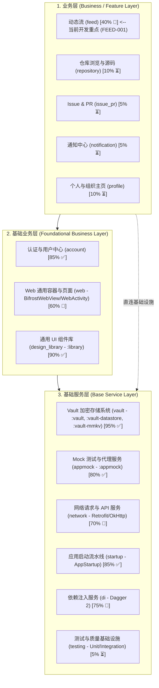

# GitHub Android 客户端项目总纲与架构规范

## 1. 项目简介与总目标

本项目是一个基于官方 **GitHub REST API v3** 构建的 Android 客户端应用，旨在提供流畅的 GitHub 移动端体验。

- **业务目标**：补齐完整的 GitHub 核心功能闭环（认证、Feed 流、仓库浏览、Issue/PR 管理、通知中心、个人/组织主页）。
- **质量目标**：保持 80% 以上的代码单元测试与集成测试覆盖率。
- **架构演进**：采用现代 Android 三层模块化架构（**业务层 -> 基础业务层 -> 基础服务层**），逐步向 **Kotlin + Coroutines + MVVM/Clean Architecture** 演进。

---

## 2. 三层架构图 (3-Tier Layered Architecture)

项目采用清晰的 **业务层 -> 基础业务层 -> 基础服务层** 单向依赖三层架构：



---

## 3. 架构分层与原子模块责任

### 层级 1：业务层 (`docs/business/`)
面向最终用户的具体功能 Feature，直接负责 UI 展现与 Feature 内部流程：
- **`feed`（动态流）**：用户 Timeline 事件流，包含 `PushEvent`、`DeleteEvent`、`CreateEvent`、`WatchEvent` 等事件卡片渲染与交互。
- **`repository`（仓库浏览与源码）**：仓库详情（Info、Code 源码树、Commits、Releases）、代码高亮展示与仓库搜索。
- **`issue_pr`（Issue 与 PR 管理）**：Issue/PR 列表展示、详情查看、发表评论与状态变更。
- **`notification`（通知中心）**：通知列表拉取、已读/未读状态与通知消息管理。
- **`profile`（个人与组织主页）**：个人/组织详细资料、Avatar 预览与关注操作。

### 层级 2：基础业务层 (`docs/business_base/`)
业务通用组件与域支撑模块，在多个业务 Feature 之间共享，带有通用业务/UI 属性：
- **`account`（认证与用户中心）**：OAuth 2.0 登录流程、Token 鉴权管理、安全注销、401 自动登出与全应用登录状态维护。
- **`web`（Web 通用容器与页面）**：`BifrostWebView` 核心 Web 控件与 `WebActivity` 通用页面容器，用于展示网页链接、H5 分享与 Web 交互。
- **`design_library`（通用 UI 组件库 - `:library`）**：通用自定义 View（如 `SwipeRefreshRecyclerView`、`EmptyView`、`LoadingView`）、UI 设计规范、Logger 框架。

### 层级 3：基础服务层 (`docs/service_base/`)
纯技术基础设施与平台服务，不包含任何具体业务逻辑，对上层提供技术支撑：
- **`vault`（Vault 加密存储系统 - `:vault`, `:vault-datastore`, `:vault-mmkv`）**：
  - `vault`：提供统一接口 `KVStorage` 与应用入口 `GHStorage`。
  - `vault-datastore`：Preferences DataStore 响应式存储引擎。
  - `vault-mmkv`：结合 Android KeyStore (AES-256-CFB) 的硬件加密 MMKV 引擎。
- **`appmock`（Mock 测试与代理服务 - `:appmock`）**：Mock API 数据引擎与代理拦截支持，辅助本地调试与集成测试。
- **`network`（网络请求与 API 服务）**：基于 Retrofit 2 + OkHttp 3 + RxJava 3/Coroutines 封装 GitHub REST API v3 客户端及全局拦截器 (`TokenAuthenticator`)。
- **`startup`（应用启动流水线）**：基于 `androidx.startup` 的模块化异步初始化机制。
- **`di`（依赖注入服务）**：基于 Dagger 2 的 Component 与 Module 全局依赖注入体系。
- **`testing`（测试与质量基础设施）**：基于 JUnit4 + Robolectric + Espresso 的测试框架，目标实现 80%+ 代码覆盖率。

---

## 4. 文档树形目录规范 (`docs/` 规范)

`docs/` 目录严格遵循三层架构的树形结构：

```
docs/
├── overview.md                             # [核心总纲] 项目总纲与三层架构图
├── progress.md                             # [核心进展] 项目总体进度表
├── coding_standards.md                     # 代码规范与指南
├── agent_knowledge_base.md                 # Agent 知识库
├── business/                               # 1. 业务层 (Business / Feature Layer)
│   ├── feed/                               # 动态流 (FEED-001 当前重点)
│   ├── repository/                         # 仓库浏览与源码
│   ├── issue_pr/                           # Issue & PR 管理
│   ├── notification/                       # 通知中心
│   └── profile/                            # 个人与组织主页
├── business_base/                          # 2. 基础业务层 (Foundational Business Layer)
│   ├── account/                            # 认证与用户中心 (ACCOUNT-001)
│   ├── web/                                # Web 通用容器与页面 (`BifrostWebView` / `WebActivity`)
│   └── design_library/                     # 通用 UI 组件库 (:library)
└── service_base/                           # 3. 基础服务层 (Base Service Layer)
    ├── vault/                              # Vault 加密存储系统
    ├── appmock/                            # Mock 测试与代理服务 (:appmock)
    ├── network/                            # 网络请求与 API 服务
    ├── startup/                            # 应用启动流水线
    ├── di/                                 # 依赖注入服务
    └── testing/                            # 测试与质量基础设施
```
