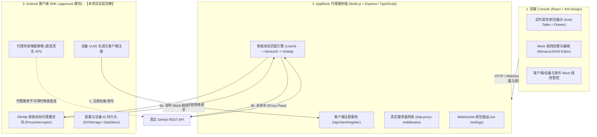

# AppMock 三端系统完整技术方案设计

## 📋 方案说明

本文档详细定义了 AppMock 系统的三端（服务端、前端 Web Console、Android 客户端 SDK）整体技术架构与详细设计方案。
**注：本项目仅要求并实现“Android 客户端 SDK (`:appmock` 模块)”部分。**

---

## 一、 系统整体架构 (System Architecture)

AppMock 采用三端分离的代理控制架构，核心原理是：**客户端将网络请求转发至代理服务端，由代理服务端根据前端配置的规则决策是“返回 Mock 数据”还是“透传至真实服务器”。**



---

## 二、 智能双标识策略 (DeviceId + UserId) 设计

针对客户端未登录状态（如 Splash 页、登录页、未登录浏览公共 API 等），使用**智能双标识策略**实现无缝衔接与匹配降级。

### 1. 客户端请求 Header 规范
每次代理请求，客户端拦截器自动带入两个 Header：
- `X-AppMock-DeviceId`: 设备 UUID（首次启动App时生成并保存在 `GHStorage` 中，**永久不变**）。
- `X-AppMock-UserId`: 当前登录账号 ID（已登录时传如 `john_doe`，**未登录或为空时留空**）。

### 2. 服务端规则匹配优先级引擎
当代理服务端收到网络请求时，按以下优先级级联决策：

```mermaid
graph TD
    A[收到客户端代理请求] --> B{Header 是否含 UserId?}
    B -- 有 UserId --> C{是否存在 UserId 专属 Mock 规则?}
    C -- 存在 --> D[应用 UserId 专属规则]
    C -- 不存在 --> E
    B -- 无/为空 --> E{是否存在 DeviceId 专属 Mock 规则?}
    E -- 存在 --> F[应用 DeviceId 专属规则]
    E -- 不存在 --> G{是否存在 全局默认 Mock 规则?}
    G -- 存在 --> H[应用 全局默认 规则]
    G -- 不存在 --> I[Proxy Pass 发往真实 API (如 api.github.com)]
```

---

## 三、 三端技术方案详细设计

### 1. 前端 Console (Web Admin Panel) 技术方案
- **技术栈选型**：**React 18 + Ant Design 5 (Antd) + TypeScript + Vite + Zustand / Redux Toolkit**
  - **组件库**：Ant Design 5 (`Layout`, `Table`, `Form`, `Modal`, `Drawer`, `Switch`, `Tag`, `Badge`, `Tabs`, `Message`)。
  - **编辑器**：`@monaco-editor/react` (提供 JSON 语法高亮与校验)。
  - **网络与长连接**：Axios + ReconnectingWebSocket。

#### 核心页面设计：
1. **实时抓包与日志监控页 (Live Request Inspector)**：
   - **请求列表 (`Antd Table`)**：显示 Method、URL、Status Code、`userId`、`deviceId`（未登录显示“匿名设备 device_a1b2”）、耗时。
   - **详情抽屉 (`Antd Drawer` + `Monaco Editor`)**：查看格式化后的 Request/Response Headers、Query、Payload。
   - **一键转 Mock (`Antd Button`)**：快捷将抓包转化为 Mock 规则。
2. **Mock 规则管理页 (Mock Rules Management)**：
   - 支持按 `UserId`、`DeviceId` 或全局维度配置 Mock 规则。
   - 规则编辑器支持匹配 Path 正则、HTTP 状态码 (200/401/403/500)、模拟延时 (0~5000ms)、自定义 Headers 与 JSON Body。
3. **设备与客户端管理页 (Devices & Clients)**：
   - 列出在线注册的设备与账号关系列表。

---

### 2. 服务端 (AppMock Proxy Server) 技术方案
- **技术栈选型**：**Node.js (v18+) + Express + TypeScript**
  - **代理中间件**：`http-proxy-middleware`。
  - **WebSocket**：`ws` 模块。
  - **数据存储**：`better-sqlite3` / `lowdb` 或 Redis。

#### 核心服务模块设计：
1. **客户端注册服务 (`POST /api/client/register`)**：
   - 接收注册：`{ deviceId: string, userId?: string, clientVersion: string, deviceModel: string, ip: string }`
2. **规则匹配引擎 (`RuleEngine`)**：
   - 依据 Header `X-AppMock-UserId` 与 `X-AppMock-DeviceId` 进行三级降级匹配（`UserId` -> `DeviceId` -> `Global`）。
3. **代理转发引擎 (`ProxyEngine`)**：
   - 命中规则则延迟后返回 Mock 数据，未命中则通过 `http-proxy-middleware` 转发真实 API 并透传响应。
4. **WebSocket 抓包推送 (`LogHub`)**：
   - 将抓包日志广播至 React 前端控制台。

---

### 3. Android 客户端 SDK (`:appmock` 模块) — *【本项目实际实现范畴】*

```
appmock/ (Android 客户端 SDK)
├── AppMock.kt                  # 客户端门面入口与注册管理
├── MockConfig.kt               # 内存配置模型
├── ProxyInterceptor.kt         # OkHttp 智能双标代理转发与降级拦截器
├── config/
│   ├── UserMockConfig.kt       # 序列化配置模型
│   └── ConfigRepository.kt     # 配置仓储接口
└── persistence/
    ├── ConfigDataStore.kt      # DataStore 持久化驱动
    └── ConfigRepositoryImpl.kt # GHStorage / DataStore 持久化实现
```

#### 客户端 4 大核心功能设计：

##### (1) 设备 ID 生成与账号注册 (`Device Identity & Registration`)
- App 首次安装时生成持久化 `deviceId`（UUID），保存在 `GHStorage` 中。
- 提供 `registerClient(userId?: String)` API 发起客户端注册与状态绑定。

##### (2) OkHttp 智能双标代理拦截器 (`ProxyInterceptor`)
- 拦截网络请求，将 URL 主机与端口改写至代理服务器。
- 请求 Header 中自动附带 `X-AppMock-DeviceId`（必带）与 `X-AppMock-UserId`（登录后附带）。

##### (3) 配置管理与本地持久化 (`GHStorage Persistence`)
- 使用 `GHStorage` / DataStore 持久化存储 `proxyHost`、`proxyPort`、`deviceId`、`userId`、`isEnabled`。
- 应用重启后自动加载历史配置。

##### (4) 线程安全与降级容错 (`Resilience & Degradation`)
- `ConcurrentHashMap` 确保多线程并发请求配置安全。
- 代理服务端连接超时、异常或断网时，捕获异常并平滑**降级走原始请求（直连真实 GitHub REST API）**，保障客户端不断网。

---

## 四、 客户端 (`:appmock`) 接口与代码范例

### 1. 客户端门面 API (`AppMock.kt`)

```kotlin
package com.pankoku.appmock

import android.content.Context
import okhttp3.Interceptor

class AppMock private constructor(private val context: Context) {

    /** 获取永久设备唯一标识 */
    val deviceId: String

    /** 设置代理服务器地址 */
    fun setProxy(host: String, port: Int): AppMock

    /** 设置代理使能状态 */
    fun setEnabled(enabled: Boolean): AppMock

    /** 设置/更新当前登录用户 ID (登出传 null) */
    fun setUserId(userId: String?): AppMock

    /** 创建 OkHttp 代理拦截器 */
    fun newInterceptor(): Interceptor

    /** 客户端注册上报至代理服务端 */
    suspend fun registerClient(): Result<Boolean>

    companion object {
        @JvmStatic
        fun getInstance(context: Context): AppMock
    }
}
```

### 2. 拦截器与智能双标降级 (`ProxyInterceptor.kt`)

```kotlin
override fun intercept(chain: Interceptor.Chain): Response {
    val original = chain.request()
    val config = appMock.config

    // 未开启代理，直接走原始请求
    if (!config.isEnabled || config.proxyHost.isBlank()) {
        return chain.proceed(original)
    }

    // 构造重定向代理请求
    val proxyUrl = original.url.newBuilder()
        .host(config.proxyHost)
        .port(config.proxyPort)
        .build()

    val builder = original.newBuilder()
        .url(proxyUrl)
        .addHeader("X-AppMock-DeviceId", appMock.deviceId)

    // 登录状态下附带 UserId Header
    if (!config.userId.isNullOrBlank()) {
        builder.addHeader("X-AppMock-UserId", config.userId)
    }

    val proxyRequest = builder.build()

    return try {
        chain.proceed(proxyRequest)
    } catch (e: Exception) {
        // 代理服务不可用/超时/异常，自动平滑降级至原始请求 (直连真实 API)
        Log.w("AppMock", "Proxy server unavailable, fallback to original request", e)
        chain.proceed(original)
    }
}
```

---

## 五、 客户端交付验收标准

1. **设备 ID 与配置持久化**：应用首次启动生成 `deviceId` 并落盘；重启后代理 Host/Port、`userId`、`deviceId` 及使能状态自动恢复。
2. **智能双 Header 传输**：开启代理后，请求附带 `X-AppMock-DeviceId`，登录状态下同时附带 `X-AppMock-UserId`。
3. **未登录完全可用**：在未登录状态下，能通过 `deviceId` 正确匹配服务端的未登录 Mock 规则。
4. **容错降级有效**：代理服务器不可用时，App 请求平滑降级直连真实 GitHub REST API，页面不崩溃不断网。
5. **单元测试**：对 `ProxyInterceptor` 与持久化逻辑补充单测，覆盖率 > 80%。
